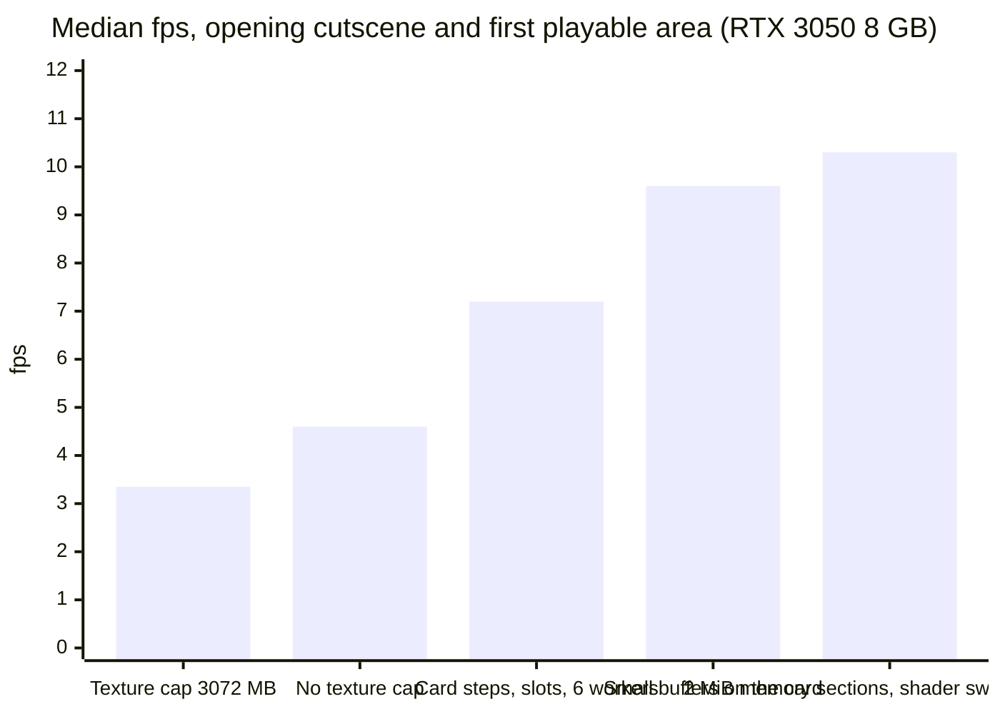
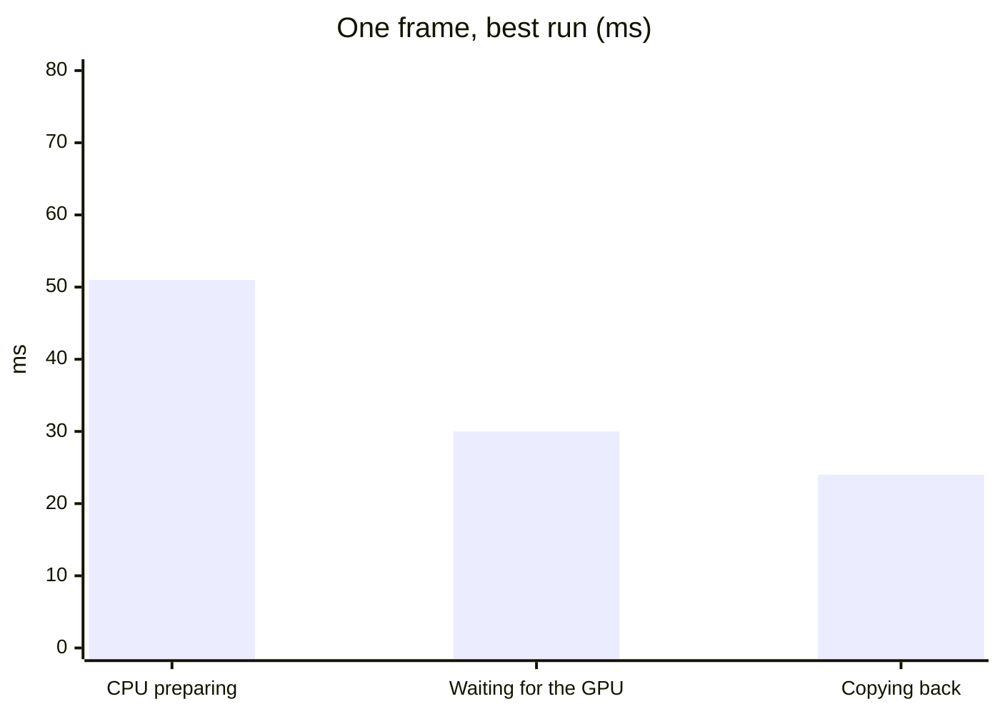

<div align="center">

# Redemption of Them All

**An Xbox-to-PC compatibility layer focused on cheaper graphics cards.**

[](https://github.com/brothernog/rota/actions/workflows/ci.yml)


</div>

It runs the **Xbox Series X|S** build (GDK, *Scarlett*) of a title natively on Windows, from your
own copy, and is tuned for low-end and older cards. The console's x86-64 code runs unchanged
inside the process. Under it sit reimplemented console system libraries (HLE) and a Direct3D 12
back end that recompiles the console's GPU programs (GFX10/RDNA2) to DXIL.

> [!IMPORTANT]
> **No games here.** This project is not affiliated with, endorsed by or connected to Microsoft
> or any game, developer or publisher. It does not provide, and will not help you get, game
> files, executables, keys, decryption, cracks or any other way around buying a game. It
> contains no game code or assets. You need your own legally obtained copy. All trademarks
> belong to their owners.

## Who it is for

| | Cards | System memory | Status |
|---|---|---|---|
| **Tested** | RTX 3050 8 GB | 32 GB | playable, ~10 fps |
| **Target** | RTX 3060, RTX 2070, other 6–8 GB cards | 16–32 GB | not measured yet |
| **Not a goal** | features that only the newest cards have | | |

Work goes, in order, into **less memory** (video memory and the PC memory it spills into are the
wall on an 8 GB card), **less work per frame** (skip passes nobody sees, copy less between the PC
and the card) and **no new-card features**: nothing here needs the newest GPUs or drivers.

## Where it is

**Playable, slowly.** On the RTX 3050 the title boots, takes input and runs through the first
mission without crashing so far, at about **10 fps** from the opening cutscene through the first
playable area (1080p, Series S profile, `diag` build, the default settings below; the best
measured run had a median of 10.3 fps, and 10% of its time was under 8.8 fps).

How the median got there, one change at a time (each bar adds to the one before it):



The last step mostly steadied the frame: the slowest 10% of the time went from under 4.1 fps to
under 8.8 fps.

Rendering at half the size (`VICTORY_RENDER_SCALE=0.5`) gives nothing on top of this (6.8 against
7.2 fps: the frame is the CPU's, not the card's) and breaks the picture (white glare, colored
blotches, checkered textures), so it is off.

Where the time of one frame goes in the best run (98 ms a frame, medians). The parts overlap (the
copy-back runs on its own thread beside the preparing), so they do not add up to the frame.



> [!NOTE]
> The default settings trade some picture for speed: shadows look softer, a little washed out,
> with card steps on (`VICTORY_CARD_STEPS=0` gives the exact ones, at a much lower frame rate),
> and a texture can show green now and then. Both are being worked on.

## What this fork adds

- **A performance overlay** (`crates/victory-gpu/src/overlay.rs`): frame rate, where the frame
  time goes (preparing, copies, textures, waiting for the GPU, copying back), draws, pipelines
  being made, textures waiting, CPU and GPU load, system and process memory, video memory and
  how much of it spilled into PC memory. A separate click-through window: no GPU work, the swap
  chain untouched. `F10` hides it, `VICTORY_OVERLAY=0` turns it off.
- **Numbers you can share.** `VICTORY_OVERLAY_CSV=<file>` writes the overlay's numbers once a
  second, and [`scripts/overlay-summary.ps1`](scripts/overlay-summary.ps1) turns a run into one
  line of medians and peaks, ready for an issue.
- **Measured defaults for 8 GB cards**, applied by `victory.exe` itself when you have not set
  them (see [Build and run](#build-and-run)); `VICTORY_TUNED=0` turns them all off. No texture
  budget cap (`VICTORY_TEXTURE_BUDGET_MB` unset).

Inherited from the forks it starts from, and kept on:

- `VICTORY_RT_MISS=1`: every ray misses. Without the ray-tracing structures built, local light
  shadows read garbage; with every ray a miss they are stable, and the programs that only feed
  those structures are skipped.
- A new texture shows in its slot only after its upload (`VICTORY_SHOW_AFTER`, on by default).
- The title's own upscaler on the Series S profile (`VICTORY_UPSCALER=6`).
- Pipeline creation tuned for NVIDIA drivers, and wave64 programs in their wide form on 32-lane
  cards.

## Build and run

You need Windows 10 or 11, a Direct3D 12 card, and Rust (the version is pinned in
`rust-toolchain.toml`).

```powershell
copy victory.example.toml victory.toml      # then point game_dir at your own copy
cargo build --locked --profile diag -p victory --features diagnostics
target\diag\victory.exe shaders <your copy's shader files>
target\diag\victory.exe run <your copy's executable> --console series-s --execute   # with VICTORY_PIPELINE_BOOK=1
target\diag\victory.exe warm --used
target\diag\victory.exe run <your copy's executable> --console series-s --execute
```

On a clean setup `warm --used` knows no pipelines yet ("0 pipelines known"): the list is written
by a run with `VICTORY_PIPELINE_BOOK=1`. So the first run is cold (dropped draws, a mostly black
picture), then warm, then run again. The warm-up's bookkeeping is kept per card, so after
switching cards `warm --used` makes that card's pipelines on its own.

### Choose a GPU

To choose a GPU, list the available adapters and use the zero-based index of the one you want.
The list shows the adapter name, dedicated video memory, and whether it can create a D3D12
feature level 12_0 device. Run the listing again after adding or removing a GPU.

```powershell
target\diag\victory.exe adapters
$env:VICTORY_ADAPTER = '0'  # replace 0 with the desired index
```

For a persistent setting, add this to `victory.toml` and use the index from your list.

```toml
[gpu]
adapter = 0
```

`VICTORY_ADAPTER` overrides the TOML value. Run `victory.exe config` to see the resolved
`gpu.adapter` setting. To return to automatic selection, clear the environment variable
with `Remove-Item Env:VICTORY_ADAPTER` and omit `adapter` from the TOML file.

The choice applies to `run`, `warm` and its workers, `replay`, and `translate --pipelines`.
When switching GPUs, select the new index before running `warm --used` and keep it set
for the subsequent `run`.

### Run settings

The settings the numbers above were measured with are the defaults: `victory.exe` sets each one
you have not set yourself, for `shaders`, `warm` and `run` alike (it prints which), and
`VICTORY_TUNED=0` sets none. They are listed in [`apps/victory/src/tuned.rs`](apps/victory/src/tuned.rs):

```text
VICTORY_RT_MISS=1  VICTORY_RELAY=2  VICTORY_THIN=0  VICTORY_PIPELINE_BOOK=1
VICTORY_MEMORY_CARD_MB=1024  VICTORY_UPSCALER=6  VICTORY_MEMORY_MAP=0
VICTORY_CARD_STEPS=1  VICTORY_CARD_ALL=1  VICTORY_DYNAMIC_SLOTS=499999  VICTORY_PIPELINE_WORKERS=6
VICTORY_SECTION_MB=2  VICTORY_RELAY_COPY=1  VICTORY_CARD_REHASH_RUNS=1
VICTORY_COMPUTE_LOD=1  VICTORY_WAVE_LDS_LOOSE=1
```

The numbers were also taken with `$env:VICTORY_DISPLAY_MODE = '1920x1080'`. To change one, set the
variable before running (for example `$env:VICTORY_CARD_STEPS = '0'`), and give `warm` and `run`
the same settings. `VICTORY_PIPELINE_WORKERS=6` suits an 8-core CPU; on fewer cores try fewer.

> [!TIP]
> Warm with the same settings as the run. A rebuild that does not change the shader translator
> keeps the warm-up (pipelines load from the layer's pipeline library); one that does needs
> `warm --used` again, or the driver makes pipelines while you play.

Keep `VICTORY_CACHE_DIR` and `VICTORY_DATA_DIR` outside this source tree: the layer refuses to
write anything derived from the title below it. Do not set `VICTORY_THIN=1` on NVIDIA cards
(it more than halves the frame rate there).

## Documentation

| | |
|---|---|
| [docs/architecture.md](docs/architecture.md) | how the layer is put together |
| [docs/asset-policy.md](docs/asset-policy.md) | what may never enter the repository |
| [docs/replay.md](docs/replay.md) | recording a frame and running it again |
| [CONTRIBUTING.md](CONTRIBUTING.md) | rules for code, commits and pull requests |
| [AGENTS.md](AGENTS.md) | build, test and measuring steps for automated agents |

## License

GPL-3.0-or-later; see [LICENSE](LICENSE). The authors of the imported code are listed in
[AUTHORS.md](AUTHORS.md). The BCPack format tables in `crates/victory-formats` are not covered
by this license; see [docs/asset-policy.md](docs/asset-policy.md).
